# 🛰️ METEOR M2-3 and M2-4

Hii :hii:, so lately I've received my own **RTL-SDR V3** (thanks to [Stardance](https://stardance.hackclub.com/@Wirenux/projects)).

### Intro

And for those who don't know what an **RTL-SDR V3** is, it's a USB dongle that allows you to hear radio signal :yay:, like: **FM radio**, **ADS-B** [^1], voice from plane and airport tower [^2] and the most interesting thing for this article : **Satellite**. But there is one caveat, the **RTL-SDR V3** (and V4) have a range from **500 kHz** to **1.75 GHz**, this means that every satellite outside of this range can’t be received without extra hardware.

<figure style="text-align: center; margin: 20px 0;">
    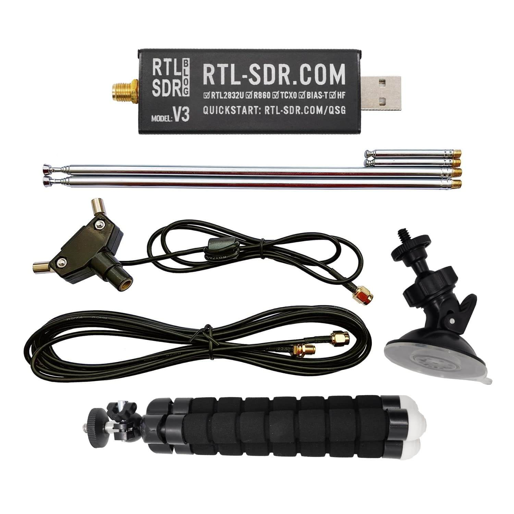
    <figcaption style="font-size: 0.9em; color: #666; margin-top: 8px;">Image: RTL-SDR V3 with the antenna kit</figcaption>
</figure>

But a lot of imagery satellite are in **S-Band** (2 - 4 GHz), **C-Band** (4 - 8 GHz) or even **X-Band** (8 - 12 GHz).

<figure style="text-align: center; margin: 20px 0;">
    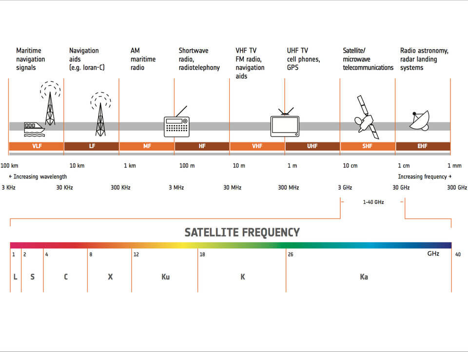
    <figcaption style="font-size: 0.9em; color: #666; margin-top: 8px;">Image: ESA - Satellite frequency bands</figcaption>
</figure>

But hopefully not all of the imagery satellite are over **1.75 GHz**, there is the **METEOR M2-3** and **METEOR M2-4** that both operate at **137.900 MHz**, this means that a **RTL-SDR V3** can get data from them :yay:.

Before showing you how to get those I'll explain the history of the **METEOR M2-3** and **M2-4**.

### The history of **METEOR M2-3** and **M2-4**

**METEOR M2-3** is a **Russian** weather satellite designed, built by **VNIIEM** and operated by **Roscosmos**. He was launched on **27 June 2023** and transmit data via **LRPT** [^3] and **HRPT**.

**METEOR M2-4** does the same thing and was launched on **29 February 2024**.

<figure style="text-align: center; margin: 20px 0;">
    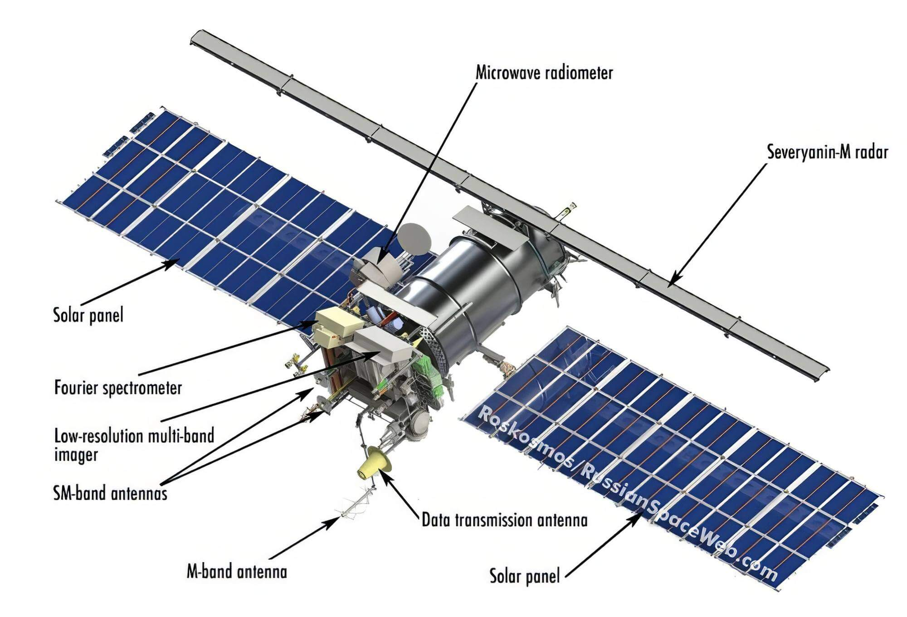
    <figcaption style="font-size: 0.9em; color: #666; margin-top: 8px;">Image: METEOR M2-3 & 4</figcaption>
</figure>

**METEOR M2-3** and **M2-4** are built on the same satellite platform

### The setup to get images from METEOR M2-X

#### First Step :yay:

In the **first** place you will need a **dipole antenna** with each antenna extend to the right length, and to know that there is a formula

For the wavelength

$$
\lambda = \frac{\text{speed of light}}{\text{frequency}}
$$

$$
\lambda = \frac{299\,792\,458}{137\,900\,000\text{ Hz}}
$$

So, now that we have the wavelength we can calculate the right length for each antenna like this

$$
\frac{\lambda}{4}
$$

This means that the right length for each antenna is : $\frac{2.173984467}{4} \approx 0.543 \text{ m} = 54.3 \text{ cm}$

But there is a little bit of antenna in the dipole it self so you can reduce each antenna length to around **51 to 53 cm**

#### Second step

The second step is the boring step (*I think...*) and it's the [**SatDump**](https://github.com/satdump/satdump) setup :yipee:.

And for that you will need to install **SatDump** : [https://github.com/satdump/satdump](https://github.com/satdump/satdump).

Once this is done you will connect your RTL-SDR V3 or V4 to your computer and the dipole antenna if **METEOR M2-3** or **M2-4** pass over you in the next **10 min**, otherwise it's not needed.

Next you will open SatDump and put those settings in the **Recorder** section

<figure style="text-align: center; margin: 20px 0;">
    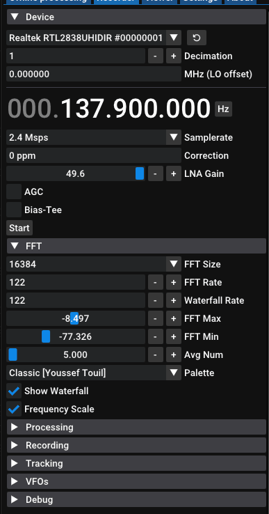
    <figcaption style="font-size: 0.9em; color: #666; margin-top: 8px;">Image: Those are the best settings that work for me</figcaption>
</figure>

<figure style="text-align: center; margin: 20px 0;">
    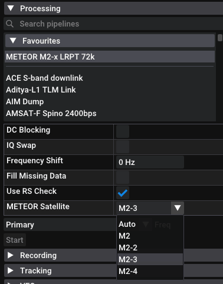
    <figcaption style="font-size: 0.9em; color: #666; margin-top: 8px;">Image: Change the mode for M2-3 or M2-4, depend on what you want to get</figcaption>
</figure>

<figure style="text-align: center; margin: 20px 0;">
    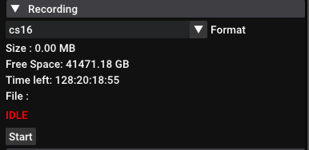
    <figcaption style="font-size: 0.9em; color: #666; margin-top: 8px;">Image: Those are the best settings that work for me</figcaption>
</figure>

*I also recommend watching this video about SatDump and METEOR M2-X: https://www.youtube.com/watch?v=XvRlZiY1-Fc*

#### Third step

And now, we wait...

You really just need to wait for **METEOR M2-3** or **M2-4** to pass over you at more than 35° if you are in a city. To know when the satellite will pass over you there is this incredible website called [N2YO.com](https://www.n2yo.com) where you can search for every satellite.

Or you can use this link that automatically add every important satellite to your tracking list : [My own n2yo list](https://www.n2yo.com/?s=44387|59051|57166|25544|33591)

Then select the satellite you want to get info about and click the **`10-DAY PREDICTION FOR ...`** just like this

<figure style="text-align: center; margin: 20px 0;">
    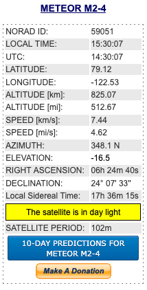
    <figcaption style="font-size: 0.9em; color: #666; margin-top: 8px;">Image: N2YO example with a METEOR M2-4</figcaption>
</figure>

#### The last step :yay:

When the satellite is 10 minutes away from you can do the same setup like in the step 2 and orient the dipole at 120° between each antenna and point to the satellite and then press Start in all three sections (like in the picture for the step 2) !

During the pass you should see something like this with the four green dot in the bottom left corner meaning the connection is nice and stable and the "hill" on the waterfall

<figure style="text-align: center; margin: 20px 0;">
    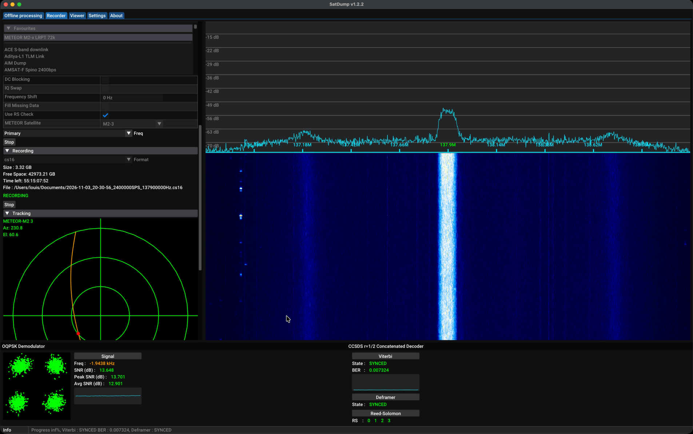
    <figcaption style="font-size: 0.9em; color: #666; margin-top: 8px;">Image: METEOR M2-3 I got yesterday</figcaption>
</figure>

At the end you should see on the bottom line some text appearing informing you that image have been created !

<figure style="text-align: center; margin: 20px 0;">
    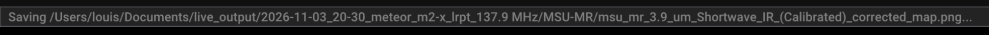
    <figcaption style="font-size: 0.9em; color: #666; margin-top: 8px;">Image: Bottom text</figcaption>
</figure>

Also each picture is **black and white** because it’s a single channel, but SatDump can combine channels to add color. So when it's the night the visible channels are dark so only the infrared one are useful

### The Result !

Here are the pictures of my best pass (and first one :yay: !)

<figure style="text-align: center; margin: 20px 0;">
    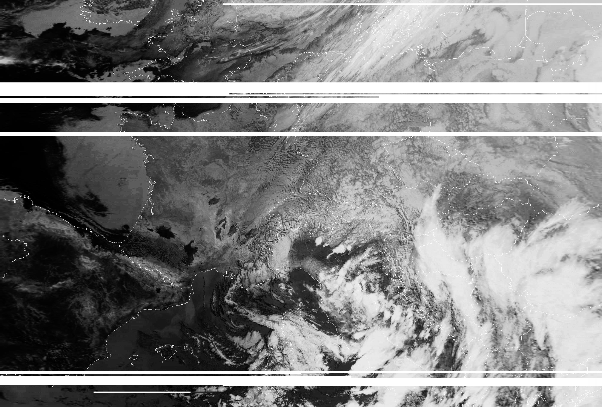
    <figcaption style="font-size: 0.9em; color: #666; margin-top: 8px;">Image: my own picture from METEOR M2-4</figcaption>
</figure>

<figure style="text-align: center; margin: 20px 0;">
    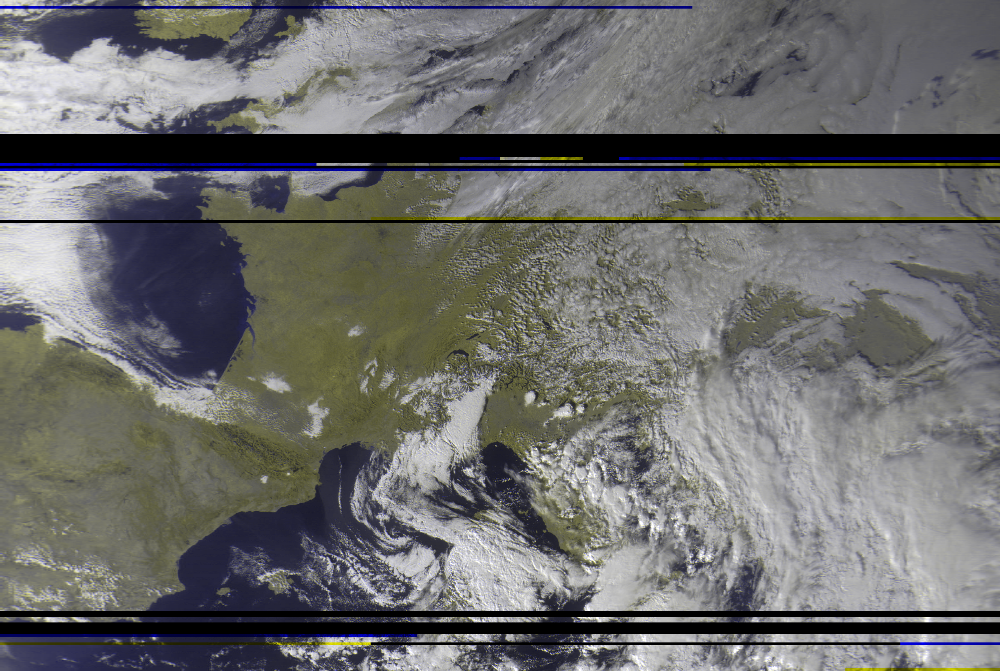
    <figcaption style="font-size: 0.9em; color: #666; margin-top: 8px;">Image: my own picture from METEOR M2-4</figcaption>
</figure>

And here are some pictures of METEOR M2-3 at night

<figure style="text-align: center; margin: 20px 0;">
    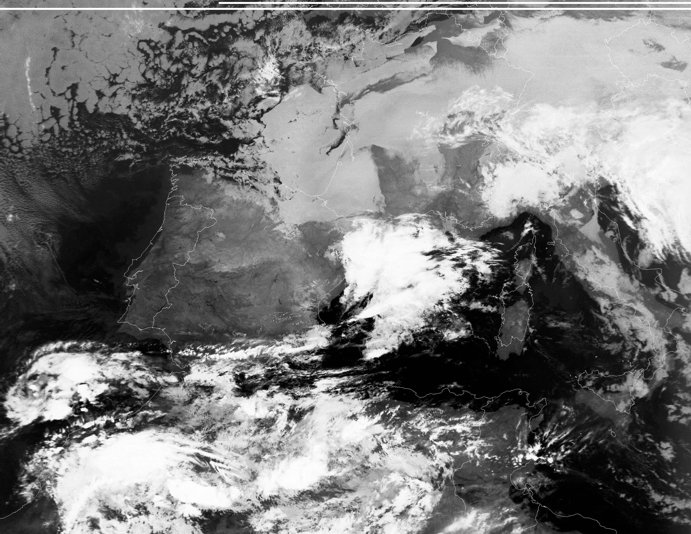
    <figcaption style="font-size: 0.9em; color: #666; margin-top: 8px;">Image: my own picture from METEOR M2-3 at night</figcaption>
</figure>

<figure style="text-align: center; margin: 20px 0;">
    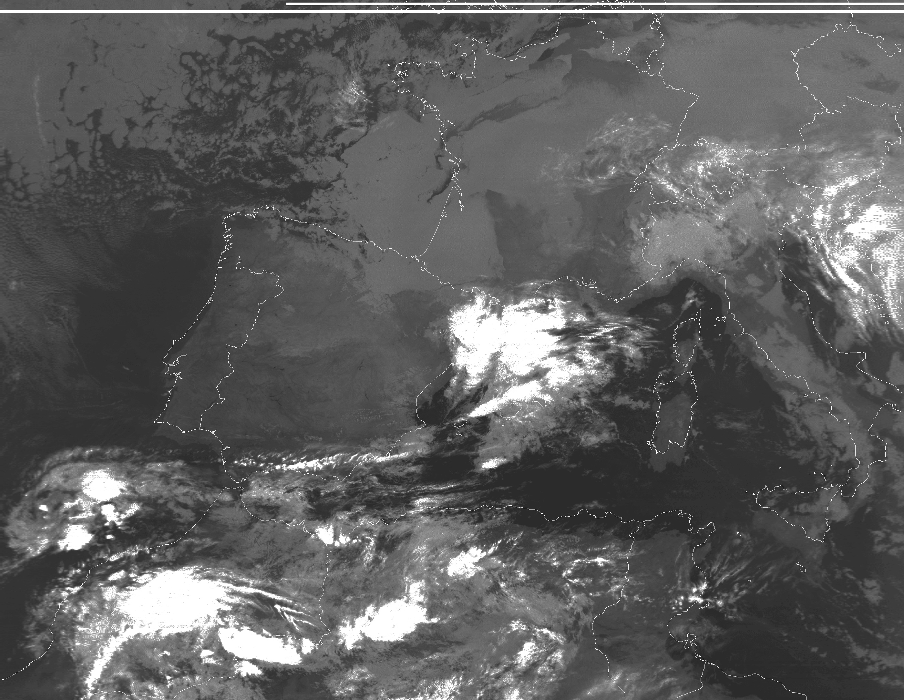
    <figcaption style="font-size: 0.9em; color: #666; margin-top: 8px;">Image: my own picture from METEOR M2-3 at night</figcaption>
</figure>

[^1]: [Wikipedia ADS-B](https://en.wikipedia.org/wiki/Automatic_Dependent_Surveillance%E2%80%93Broadcast)
[^2]: In France it's legal to ear voice from plane and airport tower but it's illegal to publish it, so before doing any of this please check the rule where you live
[^3]: [Wikipedia LRPT](https://en.wikipedia.org/wiki/Low-rate_picture_transmission)